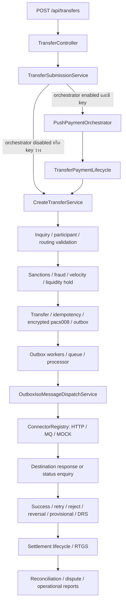

> **QA RESET 2026-10-13:** Old runtime evidence, Surefire reports and the earlier evidence snapshot have been deleted. This document describes source/test anchors only; QA results are NOT_RUN.

# Implementation trace — source → tests → evidence

วันที่: 2026-10-13 | ขอบเขต: local discovery / selected source inspection ก่อน execution audit

Paths ในตารางเริ่มจาก repository root. การพบ test file เป็นเพียง trace anchor; ยังไม่ได้ยืนยันว่า assertion ครบหรือ test ผ่านในรอบนี้

## Core transfer path ที่ trace จาก source

ส่วนหลัง settlement ใน diagram เป็น domain handoff ที่ต้อง trace transaction-level E2E เพิ่มเติม ไม่ใช่การยืนยันว่าทุก event ส่งต่ออัตโนมัติครบแล้ว

อ่าน call sites สำคัญแล้ว:

- `transfer/controller/TransferController.java` รับ `POST /api/transfers` แล้วเรียก submission service
- `transfer/service/TransferSubmissionService.java` เลือก orchestrator ตาม feature flag และ idempotency key; เมื่อ flag เปิดแต่ key ว่างยังใช้ legacy path ต้องทดสอบทั้งสอง branch
- `transfer/service/CreateTransferService.java` มี `@Transactional`, validation/route/risk/hold, save transfer/idempotency, encrypted outbound pacs008 และ `enqueueTransferDispatch`
- `outbox/service/OutboxProcessorService.java` จัดการ claim, success, business/technical failure, retry/status enquiry, provisional settlement และ DRS; outcome ต้องตรวจ invariant กับเงินจริง
- `outbox/service/OutboxIsoMessageDispatchService.java` resolve connector แล้ว dispatch ISO message และ enquire destination status
- `connector/registry/ConnectorRegistry.java` รองรับ HTTP, MQ และ MOCK; prod readiness ต้องดู actual config/DB routes ประกอบ
- `config/ProductionStartupValidator.java` active เฉพาะ prod และมี guard สำหรับ mock endpoints/routes; การพบ guard ไม่พิสูจน์ว่า deployed profile/config ผ่านแล้ว

## Trace matrix

| Domain | Source anchor (`src/main/java/com/example/switching/`) | Test anchors (`src/test/java/com/example/switching/`) | Evidence / tooling ที่ต้องตรวจ | Audit phase |
|---|---|---|---|---|
| Inquiry / account lookup | `inquiry/service/CreateInquiryService.java`, `ProductionAccountLookupService.java`, `transfer/service/CreateTransferService.java` | `iso/inquiry/`, `vpa/`, `transfer/FullTransferFlowIntegrationTest.java` | fresh valid/expired/replay/account-owner UAT; เก็บ inquiry/status-enquiry evidence ใหม่ในรอบ QA | P02 |
| Routing / participants | `routing/service/RoutingService.java`, `connector/registry/ConnectorRegistry.java` | `transfer/FullTransferFlowIntegrationTest.java`, participant/integration suites | deployed enabled routes → real bank connectors → bilateral acceptance | P02/P03 |
| Transfer / idempotency / orchestration | `transfer/service/CreateTransferService.java`, `TransferSubmissionService.java`, `paymentorchestration/` | `transfer/IdempotencyIntegrationTest.java`, `phaseii/PushPaymentOrchestratorIntegrationTest.java`, `iso/inquiry/IsoInquiryConcurrentIdempotencyIntegrationTest.java` | concurrency, payload conflict, atomicity, legacy/flag-enabled branches | P02 |
| Outbox / finality / recovery | `outbox/service/`, `outbox/queue/`, `outbox/worker/` | `outbox/OutboxConcurrentDispatchIntegrationTest.java`, `OutboxWorkerShutdownTest.java`, `FpreAmbiguousCheckIntegrationTest.java`, `FpreAutoReversalIntegrationTest.java` | crash/replay, bank timeout-after-accept, status enquiry, duplicate-effect proof | P02/P07 |
| Liquidity / risk / sanctions | `liquidity/service/PoolService.java`, `aml/`, `fraud/`, `traffic/` | `liquidity/PoolServiceIntegrationTest.java`, `aml/SanctionsScreeningIntegrationTest.java`, `traffic/` | fresh sanctions/provider evidence, holds, limits, concurrent funds invariants | P02/P05 |
| Settlement / RTGS | `settlement/service/SettlementInstructionService.java`, `RtgsGatewayService.java`, `SettlementNetPositionService.java`, `SettlementCutoffScheduler.java` | `settlement/SettlementLifecycleIntegrationTest.java`, `SettlementInstructionServiceIntegrationTest.java`, `SettlementTPlusOneIntegrationTest.java` | finance baseline, callback/retry finality, T+1/calendar, 500K benchmark | P05/P06 |
| Reconciliation / disputes | `reconciliation/service/`, `reconciliation/automation/`, `dispute/` | `reconciliation/ReconciliationIntegrationTest.java`, `dispute/DisputeAutoRefundIntegrationTest.java`, `DisputeResolutionIntegrationTest.java` | fresh mismatch cases/refund; เก็บ dispute/refund evidence ใหม่ในรอบ QA | P05 |
| SMOS / OAuth / admin | `security/`, `usermgmt/` | `security/SecurityAuthorizationIntegrationTest.java`, `security/oauth/`, `usermgmt/service/SmosSecurityCertificationIntegrationTest.java` | endpoint auth matrix, MFA/session/revocation, maker-checker และ runtime provisioning | P04 |
| RTP / promotion / cross-border / reporting | `rtp/`, `promotion/`, `paymentorchestration/`, `crossborder/` | `phaseii/`, `rtp/`, `crossborder/`, `promotion/reconciliation/` | `PHASE_II_05_24_PLAN.md`; flags default-off; enabled scopes ต้องมี runbook และ acceptance | P03/P05 |
| Legacy / Finlink additions | `settlement/service/LegacySettlementCompatibilityService.java`, `finlink/`, `crossborder/service/CrossBorderLegacyRailFacadeService.java` | `settlement/LegacySettlementCompatibility*Test.java`, `finlink/`, `crossborder/legacy/` | `docs/legacy/` phases 94–97; V118; Phase 98 protected export/audit checks | P01/P03 |
| Production config / supply chain | `config/ProductionStartupValidator.java`, `config/SchedulingConfig.java`, `security/config/SecurityConfig.java` | config/security and scripts regression suites | `.env.prod.example`, `k8s/`, `nginx/`, security/release workflows, signed live configuration | P04/P09 |
| Release / runtime closure | release scripts rather than application code | verifier/framework tests ไม่แทน runtime acceptance | `scripts/phase67/`, `phase79/`, `phase80/`, `phase98/`, `phase99/`; Phase 98/99 ต้อง execute ใหม่ | P08–P10 |

## Migration and test evidence trace

- Current inventory: V1–V118, 111 files; ดูชื่อทุกไฟล์ใน `QA_BASELINE.json`
- `docs/GO_LIVE_CRITICAL_PATH.md` ยังอ้าง V117/110; ต้อง reconcile docs/verifiers/assertions/packaged SQL และ deployed Flyway state
- Surefire XML เดิมถูกลบทั้งหมด; test status = NOT_RUN ต้องรันใหม่บน isolated DB
- `AbstractIntegrationTest.java` ใช้ shared Testcontainers PostgreSQL เมื่อมี socket; fallback local PostgreSQL มี DROP/CREATE test database จึงต้องตรวจ isolation ก่อนรัน
- Source checksum ใน QA_BASELINE ครอบคลุมไฟล์ src ปัจจุบัน ไม่ใช่ release artifact/deployment provenance

## Evidence chain สำหรับการตัดสิน Go-live

`Requirement / launch scope → frozen source + image digest → source trace → fresh automated tests → UAT real integration → capacity + recovery + security + financial evidence → signed UAT acceptance → signed production GO → staged traffic → hypercare / BAU`

สิ่งที่ต้องไม่ข้าม: schema/config/environment binding, required-test skips, actual secret rotation, real bank side effects และ financial baseline. `Status: closed`, checkbox ในเอกสารเก่า หรือ `ALL CHECKS PASS` จาก preflight ไม่ใช่หลักฐานแทน chain นี้
